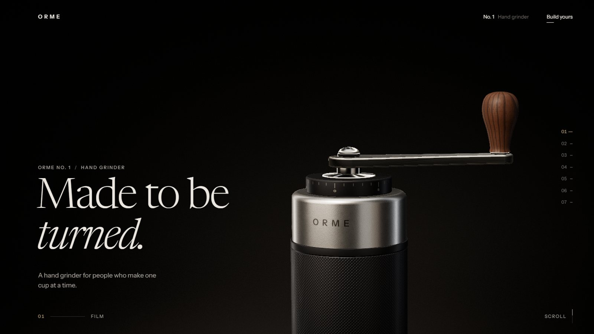
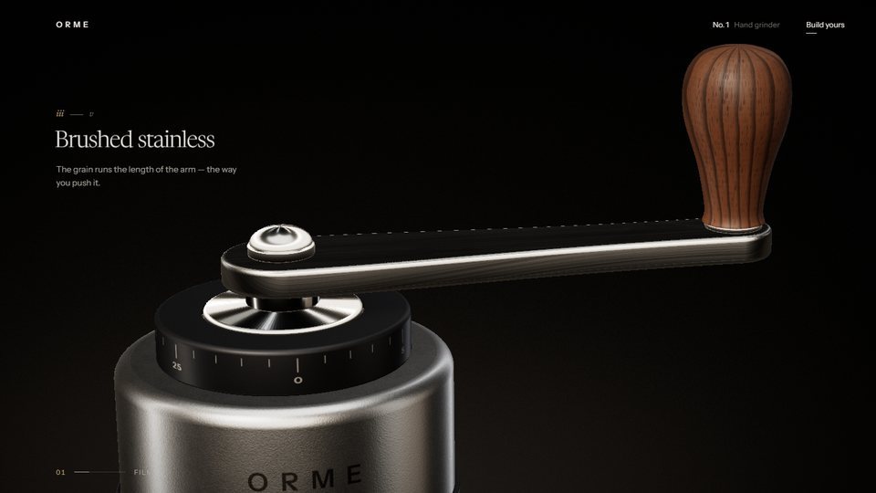
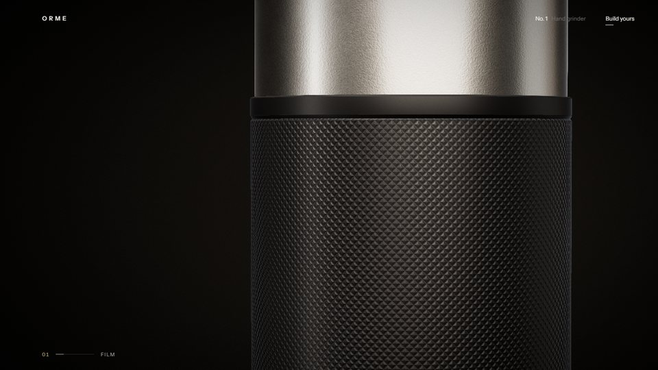
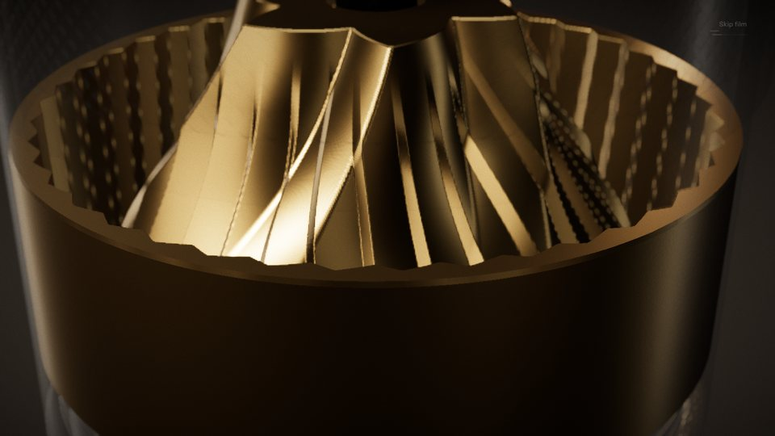
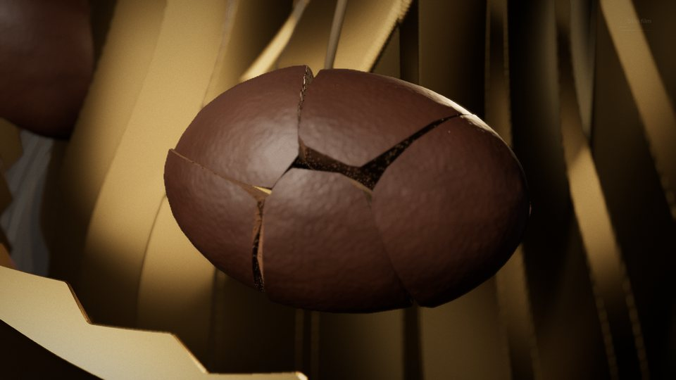
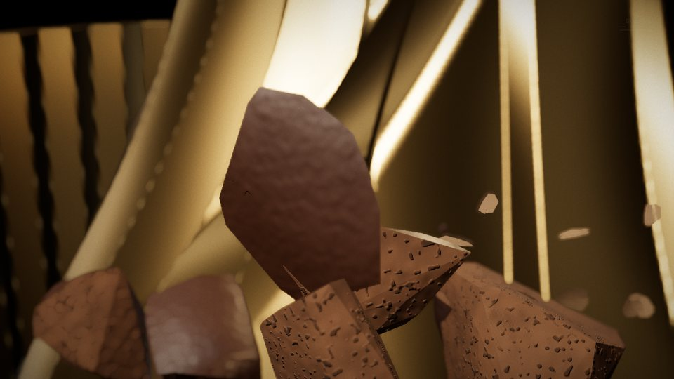
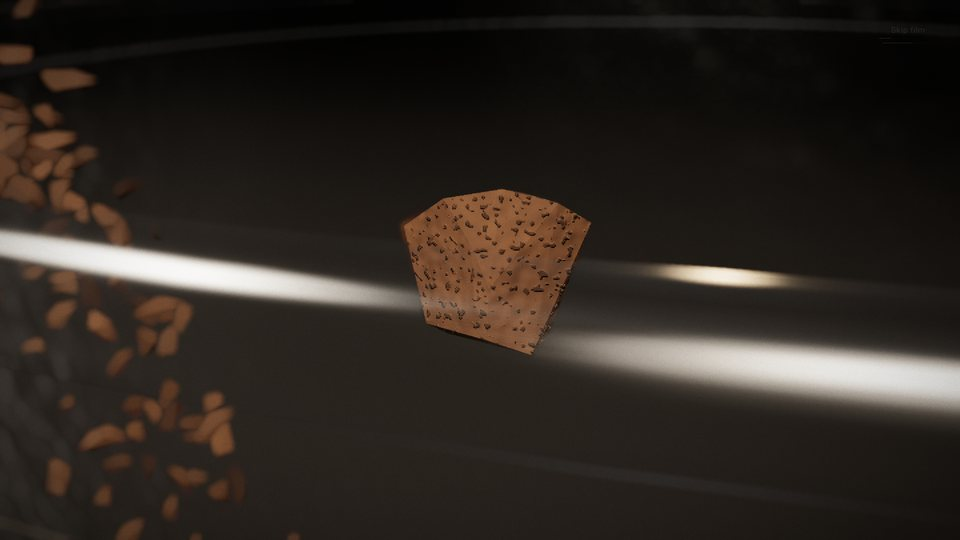
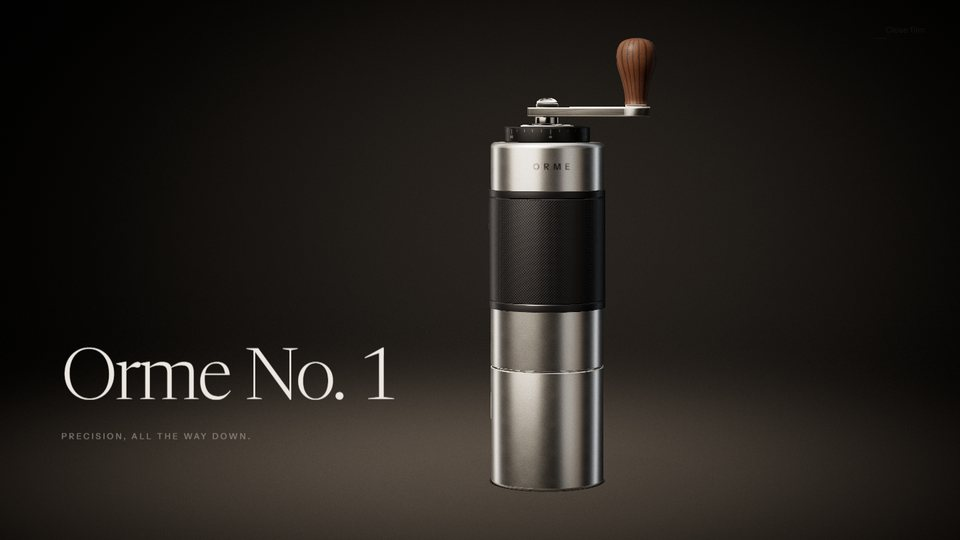

<div align="center">



# Orme No. 1

**An interactive product film for a fictional hand coffee grinder, rendered live in the browser.**

Cinematic scroll · engineering inspection · X-ray drivetrain · grind simulator · configurator · coffee lab · *Inside the Grind*

Everything is procedural: no model files, no HDRIs, no image textures.


</div>

---

## Quick start

```bash
npm install
npm run dev        # http://localhost:5173
npm run build      # typecheck + production bundle in dist/
npm run preview    # serve the production build
npm run typecheck  # tsc -b only
```

Use a recent desktop browser with WebGL 2. Quality adapts to the device automatically.

---

## Chapters

<table>
<tr>
<td width="50%"></td>
<td width="50%"></td>
</tr>
</table>

| # | Chapter | What you can do |
| --- | --- | --- |
| 01 | **Film** | Lights come up in the dark. Five macro plates (aluminium, knurl, brushed steel, walnut, the burr through a section plane), then the full reveal |
| 02 | **Engineering** | Exploded view. **Explore the engineering** (or click any part) opens Inspect: select parts in 3D or from the index, drag to orbit, Esc to step back |
| 03 | **X-ray** | The shell turns to glass behind a travelling section plane. Drag to turn the crank (it keeps spinning like a flywheel), or scroll |
| 04 | **Grind** | Pick a method or drag the dial through its detents, and the burr drops to match. **Start grinding** runs beans → burr → grounds → cup as a labelled time-lapse. **Enter the grind →** starts the film below |
| 05 | **Build** | Body, burr and knob finishes. The camera leans toward what you're choosing. **See yours** opens a turntable portrait |
| 06 | **Coffee Lab** | Method + dose → water, grind, temperature, time and flavour. The grinder's dial follows the recipe |
| 07 | **Finale** | Your configuration on a slow turntable while the light simplifies |

---

## Inside the Grind

A 37-second film, entered from the Grind chapter. The camera goes into the product and doesn't cut:

**product → X-ray → burr → one bean → fracture → one particle → thousands of grounds → the cup → the product**

<table>
<tr>
<td width="33%"><br/><sub><b>Burr</b> · evaluated on the GPU</sub></td>
<td width="33%"><br/><sub><b>Fracture</b> · cracks before it breaks</sub></td>
<td width="33%"><br/><sub><b>Fragments</b> · two-level Voronoi hulls</sub></td>
</tr>
<tr>
<td width="33%"><br/><sub><b>One particle</b> · then thousands</sub></td>
<td width="33%"><br/><sub><b>Hero</b> · the crank settles</sub></td>
<td width="33%" valign="top">

**Controls**

- **Skip film** or <kbd>Esc</kbd> at any point
- Wheel, swipe up or **Continue ↓** on the last frame returns to the page
- **Watch again** replays

</td>
</tr>
</table>

### How it works

- **Two clocks.** Film time `t` drives the camera, light and UI. Subject time `τ` slows to about 3 % inside the burr. Rotation, gravity and fracture all run on `τ`, so the speed ramp stays physically consistent. Every frame is a pure function of `t`, so the film is seekable and testable.
- **A camera planned like a cinematographer's.** Distance is interpolated in log space, so a 100× change of scale reads at a constant speed. Tracks are monotone cubic, up is always world up, and every frame has a subject.
- **Macro burr.** It is evaluated on the GPU from the same tooth profile as the product meshes, in a window that follows the lens. A wedge cutaway of the outer ring shows the cut faces as section walls. The swap to the product meshes is pixel-diff tested.
- **Fracture.** Two-level Voronoi fragments are built from the bean's real surface. The whole bean cracks along those exact lines first, so the swap to pieces reads as the cracks opening.
- **Grounds.** One instanced draw holds up to 2,580 grains, which fall under gravity in `τ` and land on a heap shaded at the same grain scale.
- **Hidden transitions.** Depth of field, tier changes and pixel-ratio changes happen only in the blackout, under the skip veil, or after the camera settles.
- **Sound-ready.** Named cues are exposed through `onCue()` in [`src/journey/timeline.ts`](src/journey/timeline.ts) or the `orme:cue` DOM event:
  `lights_down` `crank_start` `approach` `enter_body` `burr_reveal` `bean_drop` `bean_contact` `bean_fracture` `fragments_split` `particle_follow` `grounds_release` `landing` `scale_reveal` `hero_return`
- **Reduced motion.** The film becomes nine captioned stills joined by snapshot crossfades.
- **Mobile.** Phones get their own camera paths, with subjects in the central safe zone and the title at the bottom.

---

## Quality tiers

The starting tier is estimated from the GPU, DPR, viewport, cores and memory. After that, measured frame time decides. Tiers step down quickly and step up cautiously, and a tier the site had to leave is never re-entered.

| | High | Medium | Low |
| --- | --- | --- | --- |
| Pixel-ratio cap (film) | 2 (1.5) | 1.6 (1.2) | 1.25 (1) |
| Ambient occlusion | on | off | off |
| Shadow map | 2048 | 1024 | 512 |
| Macro burr grid | 1280 × 230 | 740 × 140 | 520 × 110 |
| Falling / resting grains | 880 / 1700 | 520 / 1150 | 260 / 560 |
| Depth of field (film) | full | 0.75 | off (fog falloff) |

The story is identical at every tier; only the detail changes.

---

## Architecture

```
src/
├─ content/     copy, chapters, parts, methods, recipes, finishes
├─ state/       store (React), runtime (per-frame), input hooks
├─ animation/   shots per beat, motion helpers, smooth scroll
├─ scene/       Director (camera), Studio (light), Effects, Experience
├─ models/      lathe-profiled grinder, helical burr, GPU grounds
├─ materials/   procedural maps, finishes, X-ray ghost shader
├─ config/      adaptive quality
├─ journey/     Inside the Grind
└─ ui/, styles/ beats, modes, chrome, phone compositions
```

| Area | Where | Notes |
| --- | --- | --- |
| Copy & product data | [`src/content/copy.ts`](src/content/copy.ts) | Beats, chapters, parts, methods, recipes, finishes |
| Interactive state | [`src/state/store.ts`](src/state/store.ts) | Mode, selection, config, grind. React subscribes; the render loop reads directly |
| Per-frame state | [`src/state/runtime.ts`](src/state/runtime.ts), [`src/scene/stage.ts`](src/scene/stage.ts) | Scroll, input, resolved product and studio state. DOM readouts are written from the loop |
| Shots | [`src/animation/choreography.ts`](src/animation/choreography.ts) | One desktop and one portrait shot per beat: lens shift, holds, drift, X-ray section height |
| Director | [`src/scene/Director.tsx`](src/scene/Director.tsx) | Scroll → shot → mode overrides → springs → camera. Drag contexts, dial detents, section plane, finale light |
| Grind timeline | [`src/scene/grindSim.ts`](src/scene/grindSim.ts) | Deterministic load → grind → done, with the time-lapse labelled honestly |
| Model | [`src/models/`](src/models/) | Lathe profiles with fillets, helical burr teeth, hex shaft, live materials per part, GPU grounds |
| Materials | [`src/materials/`](src/materials/) | Procedural maps, finish presets, `makeGhost` X-ray shader, `LiveMaterial` for dimming and refinishing |
| Quality | [`src/config/quality.ts`](src/config/quality.ts) | Estimated tier, then frame-time driven. Changes can be held during the film |
| Inside the Grind | [`src/journey/`](src/journey/) | `timeline` (cues, τ, burr angle), `paths` (bean, fragments, particle), `camera` (lens tracks), `direct` (per-frame resolution), `fracture` (Voronoi hulls), `MacroBurr`, `JourneyScene`, `materials`. UI is in [`src/ui/Journey.tsx`](src/ui/Journey.tsx) |
| UI | [`src/ui/`](src/ui/), [`src/styles/`](src/styles/) | Beats, modes (Inspect, Your Orme), chrome. Styles are split by concern; `responsive.css` holds the phone compositions |

---

## Accessibility

- **Reduced motion:** no smooth-scroll hijack, parallax or turntable. The camera cuts under a short fade instead of travelling, and copy fades without moving. *Inside the Grind* becomes captioned stills.
- Controls are real buttons. <kbd>Esc</kbd> steps back out of Inspect and the film.

---

## Development

Dev-only URL flags:

| Flag | Effect |
| --- | --- |
| `?tier=high\|medium\|low` | Pin the starting quality tier |
| `?tm=aces\|agx\|neutral` | Switch the tone mapper |

Console hooks during the film (dev builds only):

```js
__jseek(24)            // jump to film time t = 24 s
__journey.paused = true
__journey.speed = 0.25 // slow motion
```

---

<div align="center"><sub>Orme is a fictional brand. Everything on screen, including the product, is generated in code.</sub></div>
